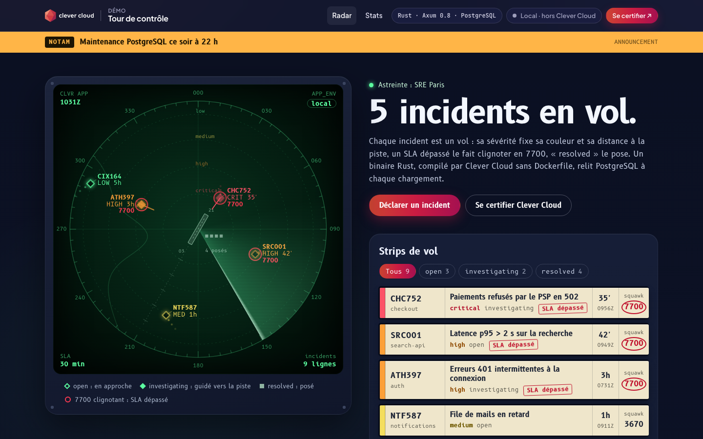
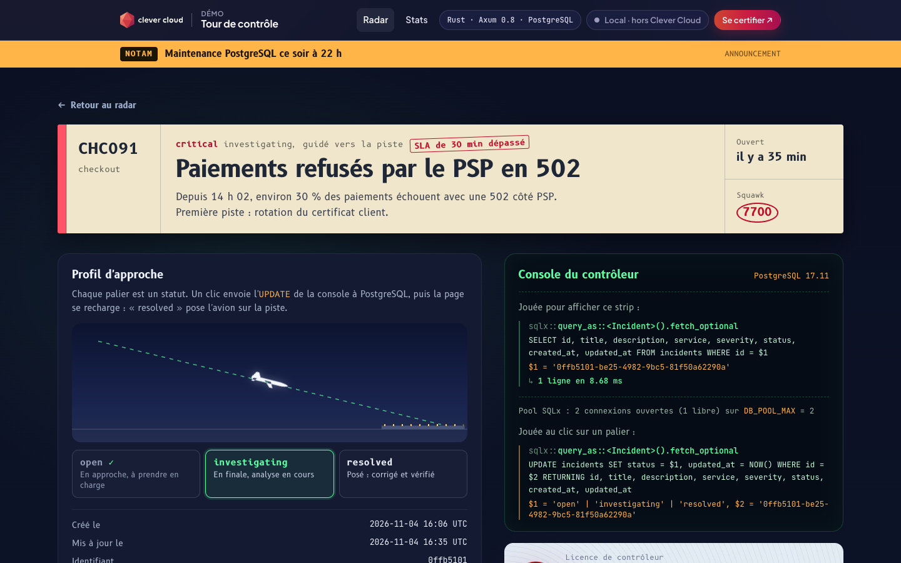
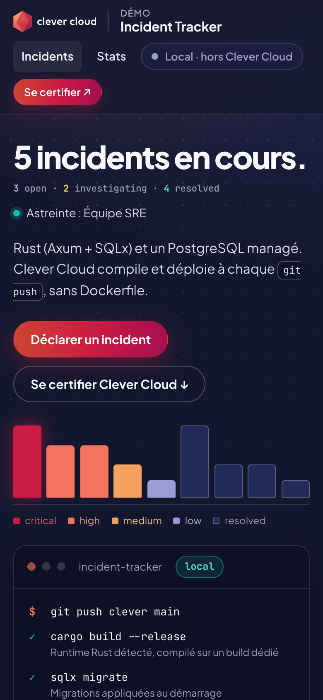

# Control Tower — Rust + PostgreSQL on Clever Cloud

> An approach radar for on-call incidents. Every open incident is an aircraft on a green phosphor scope: its severity sets its colour and its distance to the runway, a critical or high incident still open past its SLA blinks and squawks 7700, and "resolved" lands it on the runway. Beside the scope, each incident has its paper flight strip; under it, the controller's console prints the SQLx queries that drew the page, word for word as sent to the **PostgreSQL add-on**, with their bound values, row counts and timings. The app is a single Axum + SQLx binary that the **native Rust runtime** compiles with `cargo build --release --locked` on a dedicated build instance, with no Dockerfile; the schema is migrated at startup and the deployment is validated by a health check that queries PostgreSQL.







**Run it yourself.** The hosted demo was taken down after the presales review (November 2026). The steps in [Deploy on Clever Cloud](#deploy-on-clever-cloud) recreate it from scratch in about 5 minutes.

**Get certified.** This demo runs on Clever Cloud. To deploy your own apps the same way, get certified at the [Clever Cloud Academy](https://academy.clever.cloud/).

---

## What the Rust runtime does here

| Where | Clever Cloud feature | What you see |
|---|---|---|
| Build | Native Rust runtime: `cargo build --release --locked` against the committed `Cargo.lock`, on a dedicated M build instance | Measured deploys: 128 s with no cache, about 80 s once the dependency cache (`CC_CACHE_DEPENDENCIES`) is reused, 35 s for a variable change and `clever restart` (no build) |
| Start-up | The binary listens on `0.0.0.0:$PORT`, runs `sqlx::migrate!()` and reads `SHOW server_version` before serving | No migration step in the deployment: the `incidents` table is created by the app, which starts in under 100 ms. The PostgreSQL version heads the controller console |
| Deployment check | `CC_HEALTH_CHECK_PATH=/health`: `SELECT 1` on PostgreSQL, 200 or 503 | A deployment that cannot reach the database never takes the traffic |
| PostgreSQL add-on | `POSTGRESQL_ADDON_URI`, injected by the linked add-on and read directly; pool of `DB_POOL_MAX` connections | Radar and strips read from the `incidents` table on every load, status filters (`?status=`) bound as `$1`, `/stats` counted by one `COUNT(*) FILTER` query. The controller console shows each query, its binds, rows, duration and the pool usage |
| Environment variables | `APP_ENV`, `TEAM_NAME`, `SLA_CRITICAL_MINUTES`, `ANNOUNCEMENT`, set in the Console | Listed in the ATIS panel. Environment lamp on the radar, on-call team above the title, 7700 squawks and "SLA dépassé" stamps, NOTAM banner on every page. Change one, `clever restart`, reload |
| Platform variables | `CC_APP_NAME`, `APP_ID`, `INSTANCE_NUMBER`, `INSTANCE_TYPE`, `CC_PRETTY_INSTANCE_NAME`, `CC_COMMIT_ID`, `CC_DEPLOYMENT_ID` | The "Running on Clever Cloud" panel; "Local" outside the platform |
| Redeploy | SIGTERM handled: in-flight requests drained, pool closed | In-flight requests finish before the old instance stops |

How the radar reads: the four rings are the severities (critical closest to the runway, low on the outer ring), a hollow plot is `open`, a filled plot with a heading line is `investigating`, and `resolved` incidents are parked as grey squares by the runway. The callsign comes from the service name and the incident id, the data block shows the severity and the age, and the sweep lights each plot as it passes. Everything is drawn server-side in SVG by Askama: the page runs no JavaScript.

The Clever Cloud Academy certification sits at the bottom of the radar and the stats pages as a controller's licence, with the two free courses, and on every incident page as a small licence card.

---

## Deploy on Clever Cloud

You need [clever-tools](https://www.clever.cloud/developers/doc/cli/) (`clever login` done) and the ID of the organisation that will own the resources (`orga_…`, shown in the Console). Run the commands from the repo root: `clever create` links the folder to the new app.

```bash
# 1. The app and its size (fixed nano first, then the range; the dedicated build is off by default)
clever create --type rust demo-rust-postgresql --org <org_id> --region par
clever scale --flavor nano
clever scale --min-flavor nano --max-flavor XS --min-instances 1 --max-instances 2
clever scale --build-flavor M

# 2. PostgreSQL (dedicated xxs_sml, encrypted at rest), linked to the app
clever addon create postgresql-addon demo-rust-db --plan xxs_sml --option encryption=true --region par --org <org_id> --yes
clever service link-addon demo-rust-db

# 3. Variables
clever env set DB_POOL_MAX 2
clever env set CC_HEALTH_CHECK_PATH /health
clever env set CC_CACHE_DEPENDENCIES true
clever env set CC_IGNORE_FROM_BUILDCACHE target/release/deps:target/release/build:target/release/.fingerprint:target/release/incremental

# 4. Deploy
clever deploy
clever open

# 5. Optional: the nine demo incidents (needs psql; reads the add-on URI with clever env, never prints it)
./scripts/reset-demo.sh                       # targets the alias demo-rust-postgresql
CLEVER_ALIAS=my-alias ./scripts/reset-demo.sh # if the app was created or linked under another alias
```

Turn the dedicated build on **before** the first `clever deploy` and check that `clever status` shows `Dedicated build: M`: without it, `cargo build` runs on the nano/XS app instance, pins its CPU at 100 % and the deployment stalls. The build instance is only billed while a build runs. Set the fixed `nano` size before the range: `--min-flavor` alone does not shrink an instance that already runs at XS. After the deploy, `clever status` shows `running (1*nano)`, `Scalers: 1 to 2`, `Sizes: nano to XS`.

The add-on must be linked before the first deploy: without a PostgreSQL URI the app exits at startup. Encryption at rest can only be chosen when the add-on is created, and the DEV plan offers neither encryption nor more than 5 connections. `xxs_sml` keeps daily backups (7 retained).

`scripts/reset-demo.sh` truncates the table and loads `scripts/demo-seed.sql`, with dates relative to now: 3 open, 2 investigating, 4 resolved, 3 flagged "SLA dépassé" (squawk 7700) with the default 30 minutes. Run it again just before a demo so the ages start from the present. It targets the app by alias (`--alias "${CLEVER_ALIAS:-demo-rust-postgresql}"`, the name given by `clever create` above): without it, clever-tools refuses as soon as several apps are linked to the folder.

`CC_IGNORE_FROM_BUILDCACHE` works as intended: on a test deploy it brought the build cache archive from 1.3 GB down to 691 MB, the dependencies staying in the dedicated cache of `CC_CACHE_DEPENDENCIES`.

### Demo scenario

1. Reset the incidents (`./scripts/reset-demo.sh`), open the app: five aircraft in flight, three squawking 7700.
2. Declare an incident from the form: it appears on the radar at the distance of its severity, and the console shows the `SELECT` that found it.
3. Open it and click `resolved`: the plane lands on the approach profile, and the radar parks it by the runway.
4. In the Console, set `ANNOUNCEMENT` (or change `SLA_CRITICAL_MINUTES`), `clever restart`, reload: the NOTAM banner appears (or the 7700 squawks change).

An app created this way deploys from its Clever Cloud git remote: redeploy with `clever deploy`, a push to GitHub does not trigger it.

## Variables

| Variable | Set by | Role |
|---|---|---|
| `POSTGRESQL_ADDON_URI` | PostgreSQL add-on (linked) | Connection string, read directly when `DATABASE_URL` is absent. Do not copy it into `DATABASE_URL` |
| `PORT` | Clever Cloud | Listening port (8080, also the local default) |
| `DB_POOL_MAX` | you | Pool size, default 2. Keep `DB_POOL_MAX × instances` below the add-on limit (`xxs_sml` = 45): a redeploy briefly doubles the instances, 4 × 2 = 8 |
| `CC_HEALTH_CHECK_PATH` | you | `/health`: the platform validates the deployment against PostgreSQL |
| `CC_CACHE_DEPENDENCIES` | you | `true`: reuses `target/` and the cargo registry between builds |
| `CC_IGNORE_FROM_BUILDCACHE` | you | Leaves the intermediate build files out of the build cache archive: the binary is enough to run |
| `CC_RUSTUP_CHANNEL` | optional | Pins the toolchain (default `stable`, e.g. `1.94.0`). `CC_RUST_VERSION` does not exist |
| `RUST_LOG` | optional | Log filter, default `incident_tracker=info,tower_http=info` |
| `APP_ENV` | optional, demo | Environment lamp in the top-right corner of the radar, Clever gradient when `production`. Default `local` |
| `TEAM_NAME` | optional, demo | "Astreinte : …" above the title. Default `Équipe SRE` |
| `SLA_CRITICAL_MINUTES` | optional, demo | Critical and high incidents still unresolved after this many minutes blink on the radar, squawk 7700 and get a "SLA dépassé" stamp on their strip. Default `30` |
| `ANNOUNCEMENT` | optional, demo | NOTAM banner on every page when set |
| `DATABASE_URL` | you, local only | PostgreSQL connection string for a local run, takes precedence when set |
| `CLEVER_ALIAS` | you, `scripts/reset-demo.sh` only | Alias of the app whose add-on is reloaded. Default `demo-rust-postgresql` |

The "Running on Clever Cloud" panel shows `CC_APP_NAME`, `APP_ID`, `INSTANCE_NUMBER`, `INSTANCE_TYPE`, `CC_PRETTY_INSTANCE_NAME`, `CC_COMMIT_ID` (7 characters) and `CC_DEPLOYMENT_ID` (16 characters), and nothing else.

## Routes

| Method | Path | What it does |
|---|---|---|
| GET | `/` | Radar, flight strips and controller console (`?status=open`, `investigating` or `resolved` filters both) |
| GET | `/incidents/new` | Form to declare an incident (a blank strip) |
| POST | `/incidents` | Creates an incident (title ≤ 255, service ≤ 100, description ≤ 10 000 characters: a form error, never a 500) |
| GET | `/incidents/{id}` | Incident detail: the flight strip and the approach profile |
| POST | `/incidents/{id}/status` | Moves the incident to `open`, `investigating` or `resolved` |
| GET | `/stats` | Traffic report: counts by status and severity |
| GET | `/health` | 200 when PostgreSQL answers `SELECT 1`, 503 otherwise |
| GET | `/cc-brand.css` | Clever Brand Kit stylesheet, embedded in the binary |
| GET | `/tower.css` | The control tower styles (radar, strips, console, licence), embedded in the binary |

There is no delete. Every response carries `X-Content-Type-Options`, `Referrer-Policy`, `X-Frame-Options` and a `Content-Security-Policy` that allows no script; TLS and HSTS stay on the Clever Cloud proxy.

## Code tour

```
src/main.rs              config, pool, migrations, router (app()), security headers, graceful shutdown, route tests
src/handlers.rs          HTTP handlers, form validation, timed SQLx calls for the console, Askama templates
src/db.rs                the SQL as constants (shown as is by the console), list, create, update status, stats
src/models.rs            Incident (age, SLA, callsign, squawk), Radar (plot geometry), QueryLog, Platform
migrations/              0001_create_incidents.sql: the incidents table, run by sqlx::migrate!() at startup
templates/               base (topbar, NOTAM, footer), index (radar room), new, detail, stats; partials/ holds the
                         radar, the console log, ATIS, the platform panel, the licence and the Clever logo and badge
static/cc-brand.css      Clever Brand Kit, copied as is and embedded with include_str!
static/tower.css         the control tower universe (B612 and B612 Mono, the Airbus cockpit typefaces)
scripts/                 demo-seed.sql (9 incidents) and reset-demo.sh (reloads the add-on of CLEVER_ALIAS)
clevercloud/rust.json    historical: "appIsToBeBuilt" has no effect, the Rust runtime builds the app without
                         this file (tested); it is kept but the runtime is configured through environment variables
```

Axum 0.8, Tokio, SQLx 0.8 (PostgreSQL, rustls), Askama 0.12; Rust edition 2021, `rust-version` 1.85. Axum 0.8 path parameters use `{id}`: the former `:id` syntax panics at startup. `cargo test` runs 13 tests without a database (radar geometry, squawks, SLA, page rendering, routes and headers).

## Run locally

Needs Rust 1.85+ and a local PostgreSQL.

```bash
createdb demo_rust
DATABASE_URL=postgres://localhost/demo_rust PORT=8080 cargo run   # migrations run at startup
psql postgres://localhost/demo_rust -f scripts/demo-seed.sql      # optional: the nine demo incidents
# → http://localhost:8080
cargo test                                                         # no database needed
```

`cp .env.example .env` also works: the app reads a `.env` file when there is one (local only).
